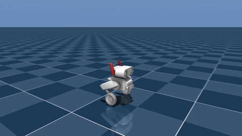
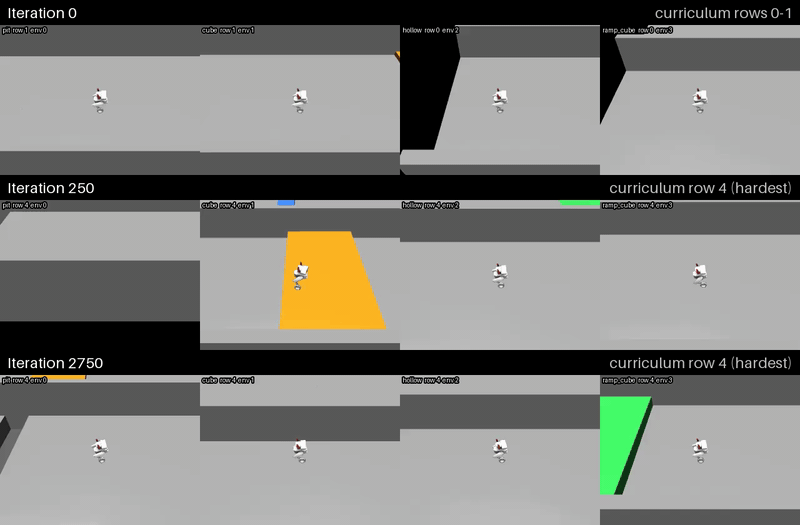
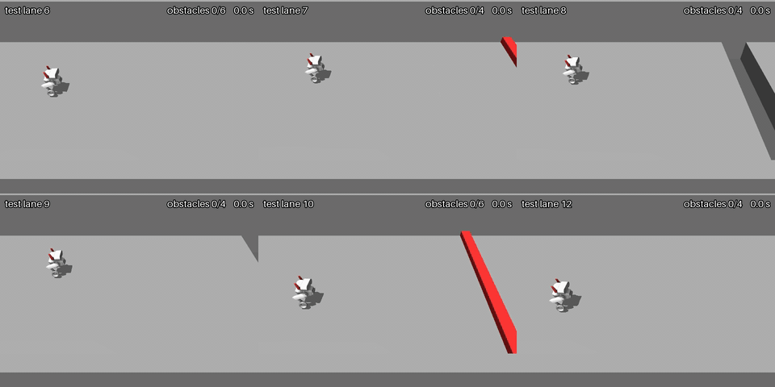

#  BENI PARKOUR

A policy that sees only a depth image drives the BENI wheel-legged robot through obstacle lanes: it jumps pits, cubes
and bars, crawls under tunnels and climbs ramps. Everything is trained and tested in simulation.

**[Try it in your browser](https://huggingface.co/spaces/XueruiWang/beni-parkour)**: build a course and watch the
robot cross it.

## What we did

BENI is the small wheel-legged robot of [OpenBeni](https://github.com/Mondo-Robotics/open-beni). Its released policy
drives, balances and jumps on flat ground. This project builds a parkour controller on top of it in three steps:

1. **Low-level skills.** Two policies turn commands into joint actions: one jumps, one drives with the body lowered
   (crawl).
2. **A high-level policy.** It reads a depth image 20 times a second and decides how fast to drive, how low to crouch
   and when to jump. It learns on single obstacles that get harder as it succeeds (env1, a curriculum).
3. **Generalization.** It then trains on lanes of 4 to 6 mixed obstacles of random size and spacing (env2), and is
   tested on lanes it never trained on.

The final policy also runs in a web page, where anyone can build a course for it.

## 1. Low-level skills: jump and crawl

The high-level policy does not move joints. It commands two low-level policies, which run at 100 Hz and stay frozen:

| Skill | Policy | What it does |
| --- | --- | --- |
| Jump | the policy released with OpenBeni (`assets/models/policy_best.pt`), unchanged | drives, and jumps on a trigger: the base rises from 0.11 m to about 0.31 m |
| Crawl | fine-tuned by us from that policy (`python/beni_rl_crawl`) | drives with the body at a commanded height, down to 0.067 m |

The fine-tuned policy lost most of its jump while it learned to crouch, so both policies are kept. The crawl policy
drives by default; the jump policy takes over from a jump trigger until shortly after touchdown.

The four clips show the two policies under scripted commands on flat ground, without a high-level policy.

| Jump | Crawl |
| :---: | :---: |
|  |  |
| **Jump while driving** (1.0 m/s) | **Crawl while driving** (0.8 m/s) |
|  |  |

## 2. A high-level policy: depth image and curriculum (env1)


**What it sees.** A depth image of 80 x 60 pixels from the front camera, turned into 440 numbers by a frozen
[DeFM](https://github.com/leggedrobotics/defm) encoder (RegNetY-400MF), and 24 numbers about its own body: angular
velocity, the direction of gravity, joint positions and speeds, its last action, the state of the jump and the
distance to the goal. It gets no map of the lane and no true velocity.

**What it decides.** A forward speed (0 to 1.5 m/s), a body height (0.067 to 0.110 m) and a jump trigger. A scripted
heading hold keeps the robot along its lane, so the policy does not steer.

**How it learns.** PPO with a recurrent actor and critic. Only the critic sees privileged simulator state (true
velocity, the next obstacle, the time left). An episode succeeds when the robot stops upright at the goal within the
time budget of its lane.

**env1** has one obstacle per lane, of five kinds in five difficulty rows. Row 0 is flat; rows 1 to 4 grow as follows:

| Obstacle | The robot has to | Rows 1 to 4 |
| --- | --- | --- |
| Pit | jump across | width 0.15 to 0.35 m |
| Cube | jump onto it | height 0.06 to 0.12 m |
| Bar (thin cube) | jump over it | height 0.06 to 0.12 m |
| Tunnel (hollow) | crawl under it | clearance 0.26 down to 0.20 m |
| Ramp and cube | drive up and over | slope 8 to 20 degrees |

Each of the 1280 robots moves up a row after five successes in a row and down a row after two failures in a row
before its obstacle. In our run the robots went from rows 0 and 1 to the hardest row within the first 250 of 3000 PPO
iterations; at the end the running success rate on the hardest row was between 92% (cube) and 100% (ramp).



*Videos recorded during the env1 run. Rows: PPO iteration 0, 250 and 2750. Columns: pit, cube, tunnel, ramp.*

## 3. Generalization: lanes of mixed obstacles (env2)

A real course has more than one obstacle. In env2 every lane has 4 to 6 obstacles: each of a random kind, with a size
drawn from the whole range of env1, 2 to 4 m after the one before it. There are five layouts of 16 lanes. Four are
for training (64 lanes); the fifth is the test layout, which no training robot is ever put on.

Training starts from the env1 policy with a new critic, and for the first 50 iterations only the critic learns. There
is no curriculum: after every episode a robot moves to a random training layout.

<p align="center">
  
</p>

*The four training layouts, drawn on top of each other. Each lane is 37 m long; the first 28 m are shown.*

The run lasted 3000 iterations. We release the policy of iteration 1000 (`python/parkour_rl/checkpoints/`): the last
one was no better on the test layout (51 of 80 episodes against 54) and had forgotten more of env1.

## Results



*The final policy on six lanes of the test layout, each until its episode ends. One episode was run on each of the
16 test lanes and the robot reached the goal on 11; the clip shows six of those 11.*

Goal reached, over 5 episodes per lane with a random start and goal and with deterministic actions:

| Policy | Training layouts (64 lanes) | Test layout (16 lanes) |
| --- | :---: | :---: |
| env1 policy, before any training on env2 | 60% (191/320) | 61% (49/80) |
| env2 policy, iteration 1000 (released) | **78%** (249/320) | **68%** (54/80) |

The released policy passes every obstacle of the lane in 80% of the episodes on the training layouts and in 88% on
the test layout. The episodes that pass every obstacle and still fail do so between the last obstacle and the stop at
the goal.

## Web demo

**https://huggingface.co/spaces/XueruiWang/beni-parkour**

[](https://huggingface.co/spaces/XueruiWang/beni-parkour)

*A full session in the web demo: five obstacles, two sizes changed, then the race (editing shown 1.6 times faster,
the race in real time). [MP4](python/parkour_rl/media/web_demo.mp4)*

Choose 4 to 6 obstacles, drag them into the lane, set their sizes and spacing, and the same policy drives the robot
across. The page shows what the policy sees (the depth image) and what it decides (speed, body height, jump).

Everything runs in the visitor's browser: MuJoCo compiled to WebAssembly for the physics, ray casting for the depth
camera, ONNX Runtime Web for the four networks and three.js for the picture. The JavaScript simulation is a port of
the Python code and was checked against it step by step. Over 400 episodes on the env2 lanes it reaches the goal in
75% of them, against 76% in Python. See [parkour_web/README.md](parkour_web/README.md).

## Repository

| Path | Contents |
| --- | --- |
| `python/parkour_rl/` | the high-level task: lanes, env1 and env2, the hierarchy, depth encoder, rewards, training, evaluation |
| `python/parkour_rl/checkpoints/`, `low_level_policy/`, `depth_model/` | the released high-level policy, the two frozen low-level policies, the DeFM weights |
| `python/parkour_rl/media/` | the clips and pictures of this page, made by `make_media.py` |
| `python/beni_rl_crawl/` | the fine-tune that gave the crawl policy |
| `python/beni_rl/`, `assets/`, `web/` | OpenBeni: low-level training, robot model, its own browser game |
| `parkour_web/` | the web demo |

## Running it

The Python environment is that of OpenBeni (Python 3.12, `uv sync --locked`); see
[README_OpenBeni.md](README_OpenBeni.md). Run the commands from the `python` directory:

```bash
cd python
uv run python -m parkour_rl.check env2       # a scripted driver on every lane: checks the setup, no policy needed
uv run python -m parkour_rl.train env1       # step 2: 1280 robots, 3000 iterations
uv run python -m parkour_rl.train env2       # step 3: starts from the env1 run named in env2.py
uv run python -m parkour_rl.evaluate env2 parkour_rl/checkpoints/env2_model_1000.pt 5   # the table above
uv run python -m parkour_rl.play env2 --checkpoint-file parkour_rl/checkpoints/env2_model_1000.pt
uv run python -m parkour_rl.make_media results   # also: skills, stages, layouts
```

Training needs a GPU: env2 took about 12 s per iteration on our machine, 10 hours in all. Evaluation and the media
script also run on a CPU. After your own env1 run, pass its checkpoint to the env2 training with
`--agent.init-checkpoint <file>`.

The web demo needs Node 22:

```bash
cd parkour_web
npm ci
npm run dev        # http://localhost:5173
```

## Credits and license

- [OpenBeni](https://github.com/Mondo-Robotics/open-beni) by Mondo Robotics: the robot, its model, the low-level
  training code and the jump policy. This repository starts from its source.
- [mjlab](https://github.com/mujocolab/mjlab) and MuJoCo Warp for the simulation,
  [rsl_rl](https://github.com/leggedrobotics/rsl_rl) for PPO.
- [DeFM](https://github.com/leggedrobotics/defm) (ETH Zurich, Manthan Patel) for the depth encoder.
- MuJoCo, ONNX Runtime Web and three.js in the web demo.

The code is under the MIT license of OpenBeni ([LICENSE](LICENSE)). The DeFM weights and preprocessing code are under
Apache-2.0; [NOTICE.md](NOTICE.md) lists the third-party parts.
