# 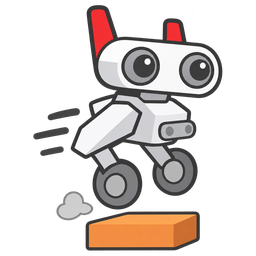 BENI PARKOUR

The BENI wheel-legged robot crosses obstacle lanes from a depth image alone: it jumps pits, cubes and bars, crawls
under tunnels and climbs ramps. Two high-level controllers drive it: a policy trained with reinforcement learning,
and a language model that is only given instructions. Both command the same low-level skills and are tested on the
same lanes. Everything runs in simulation.

**[Try it in your browser](https://huggingface.co/spaces/XueruiWang/beni-parkour)**: build a course and watch the
trained policy cross it.

## What we did

BENI is the small wheel-legged robot of [OpenBeni](https://github.com/Mondo-Robotics/open-beni). Its released policy
drives, balances and jumps on flat ground. This project builds a parkour controller on top of it, in two ways that
share the same low-level skills:

1. **Low-level skills.** Two policies turn commands into joint actions: one jumps, one drives with the body lowered
   (crawl). Neither controller below moves a joint itself.
2. **RL controller.** A policy trained with PPO reads a depth image 20 times a second and decides how fast to drive,
   how low to crouch and when to jump. It learns on single obstacles that get harder as it succeeds (env1), then on
   lanes of 4 to 6 mixed obstacles (env2), and is tested on lanes it never trained on.
3. **LLM controller.** A language model takes the place of that policy. It is not trained: it gets written
   instructions, the same depth image and body state, and answers with the same three commands.
4. **Comparison.** Both controllers drive the 16 test lanes from the same start and goal points.
5. **Web demo.** The trained policy also runs in a web page, where anyone can build a course for it.

## 1. Low-level skills: jump and crawl

A high-level controller does not move joints. It commands two low-level policies, which run at 100 Hz and stay frozen:

| Skill | Policy | What it does |
| --- | --- | --- |
| Jump | the policy released with OpenBeni (`assets/models/policy_best.pt`), unchanged | drives, and jumps on a trigger: the base rises from 0.11 m to about 0.31 m |
| Crawl | fine-tuned by us from that policy (`python/beni_rl_crawl`) | drives with the body at a commanded height, down to 0.067 m |

The fine-tuned policy lost most of its jump while it learned to crouch, so both policies are kept. The crawl policy
drives by default; the jump policy takes over from a jump trigger until shortly after touchdown.

The four clips show the two policies under scripted commands on flat ground, without a high-level controller.

| Jump | Crawl |
| :---: | :---: |
| 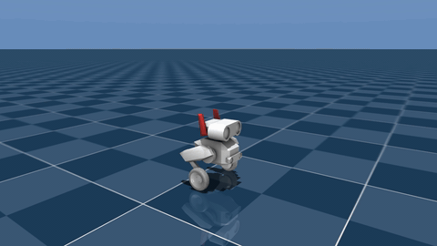 | 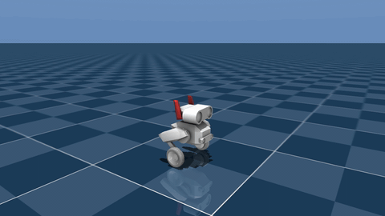 |
| **Jump while driving** (1.0 m/s) | **Crawl while driving** (0.8 m/s) |
| 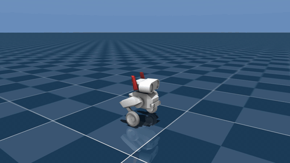 |  |

## 2. RL controller

### 2.1 The policy and its curriculum (env1)

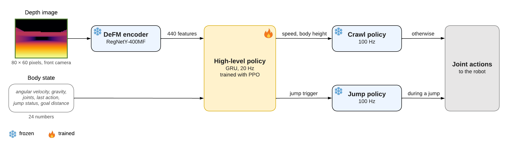

**What it sees.** A depth image of 80 x 60 pixels from the front camera, turned into 440 numbers by a frozen
[DeFM](https://github.com/leggedrobotics/defm) encoder (RegNetY-400MF), and 24 numbers about its own body: angular
velocity, the direction of gravity, joint positions and speeds, its last action, the state of the jump and the
distance to the goal. It gets no map of the lane and no true velocity.

**What it decides.** A forward speed (0 to 1.5 m/s), a body height (0.067 to 0.110 m) and a jump trigger. A scripted
heading hold keeps the robot along its lane, so the policy does not steer.

**How it learns.** PPO with a recurrent actor and critic. Only the critic sees privileged simulator state (true
velocity, the next obstacle, the time left). An episode succeeds when the robot stops upright at the goal within the
time budget of its lane.

**env1** has one obstacle per lane, of five kinds in five difficulty rows. Row 0 is flat; rows 1 to 4 grow as follows:

| Obstacle | The robot has to | Rows 1 to 4 |
| --- | --- | --- |
| Pit | jump across | width 0.15 to 0.35 m |
| Cube | jump onto it | height 0.06 to 0.12 m |
| Bar (thin cube) | jump over it | height 0.06 to 0.12 m |
| Tunnel (hollow) | crawl under it | clearance 0.26 down to 0.20 m |
| Ramp and cube | drive up and over | slope 8 to 20 degrees |

Each of the 1280 robots moves up a row after five successes in a row and down a row after two failures in a row
before its obstacle. In our run the robots went from rows 0 and 1 to the hardest row within the first 250 of 3000 PPO
iterations; at the end the running success rate on the hardest row was between 92% (cube) and 100% (ramp).


*Videos recorded during the env1 run. Rows: PPO iteration 0, 250 and 2750. Columns: pit, cube, tunnel, ramp.*

### 2.2 Generalization: lanes of mixed obstacles (env2)

A real course has more than one obstacle. In env2 every lane has 4 to 6 obstacles: each of a random kind, with a size
drawn from the whole range of env1, 2 to 4 m after the one before it. There are five layouts of 16 lanes. Four are
for training (64 lanes); the fifth is the test layout, which no training robot is ever put on.

Training starts from the env1 policy with a new critic, and for the first 50 iterations only the critic learns. There
is no curriculum: after every episode a robot moves to a random training layout.

<p align="center">
  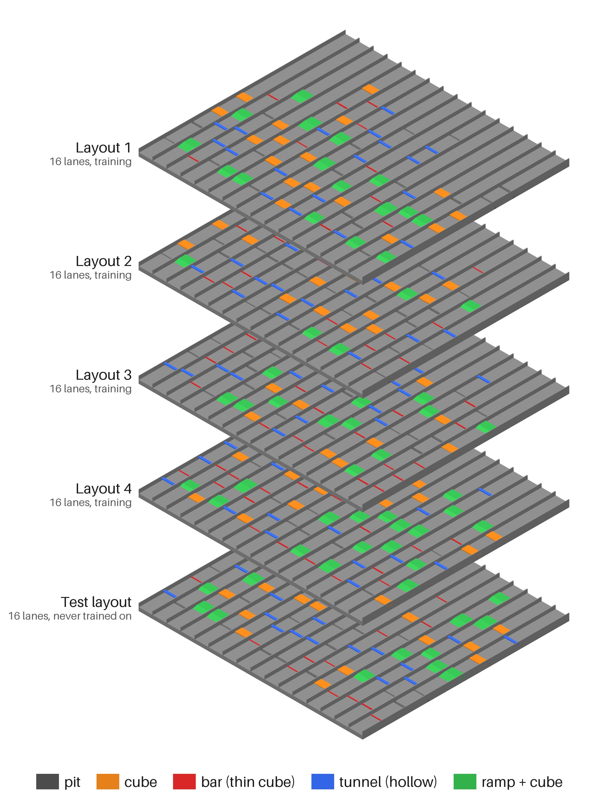
</p>

*The four training layouts and the test layout, drawn on top of each other. Each lane is 37 m long; the first 30 m
are shown.*

The run lasted 3000 iterations. We release the policy of iteration 1000 (`python/parkour_rl/checkpoints/`): the last
one was no better on the test layout (51 of 80 episodes against 54) and had forgotten more of env1.

### 2.3 Results


Episodes that reach the goal. Every lane is run for 5 episodes, each with a new random start and goal, with
deterministic actions; the counts are episodes, not lanes.

| Policy | Training layouts (64 lanes × 5 episodes = 320) | Test layout (16 lanes × 5 episodes = 80) |
| --- | :---: | :---: |
| env1 policy, before any training on env2 | 60% (191/320) | 61% (49/80) |
| env2 policy, iteration 1000 (released) | **78%** (249/320) | **68%** (54/80) |

### 2.4 Training and testing

The Python environment is that of OpenBeni (Python 3.12, `uv sync --locked`); see
[README_OpenBeni.md](README_OpenBeni.md). Run the commands from the `python` directory:

```bash
cd python
uv run python -m parkour_rl.train env1       # 2.1: 1280 robots, 3000 iterations
uv run python -m parkour_rl.train env2       # 2.2: starts from the env1 run named in env2.py
uv run python -m parkour_rl.evaluate env2 parkour_rl/checkpoints/env2_model_1000.pt 5   # 2.3: the table above
```

Training needs a GPU: env2 took about 12 s per iteration on our machine, 10 hours in all. Evaluation also runs on a
CPU. After your own env1 run, pass its checkpoint to the env2 training with `--agent.init-checkpoint <file>`.

## 3. LLM controller

### 3.1 How it works

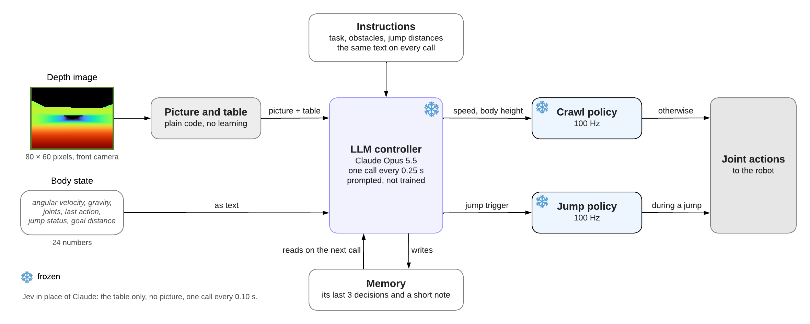

The language model sits where the trained policy sits. It is given what that policy is given and returns what that
policy returns; only the form differs, because a language model reads pictures and text, not feature vectors.
Nothing is trained. What the RL policy found by trial and error, the model is told: the instructions say what each
obstacle needs and at which distance to jump.

**What it gets on every call.**

- The instructions: one fixed text (3.2).
- The depth image of 80 x 60 pixels, as a picture coloured by distance.
- The depth table: the same frame written as numbers (3.3).
- The 24 body numbers, as named text.
- Its own last three decisions, and a note of at most 30 words that it left itself on the call before. This is its
  only memory.

**What it answers.** One or two sentences on what is ahead, then the commands of the RL policy: a forward speed (0
to 1.5 m/s), a body height (0.067 to 0.110 m) and the step on which to trigger a jump, or none. Then the note for
its next call.

**When it is called.** Once every 0.25 s of simulated time, which is 5 steps of the RL policy; the commands hold in
between. The simulation is paused while the model answers, so a slow answer costs money and not performance.

**Models.** Claude Opus 5.5 and Claude Haiku 5.5 get the picture and the table. Jev, a text-only model by TypeSafe,
gets the table alone and is called every 0.10 s.

### 3.2 The prompt

The instructions have six parts: the role and the call rhythm, the task and how an episode fails, the three
commands and how a jump works, the five obstacles with the distance at which to act on each, how to read the camera
picture and the depth table, and the form of the reply.

<details>
<summary>The full instructions, as given to Opus and Haiku (line breaks added)</summary>

```text
You are the high-level controller of BENI, a small wheel-legged robot driving along a straight, walled
obstacle lane in a physics simulation. The robot balances on two wheels at the end of two legs; its body rides
about 0.11 m above the floor when it stands. Lower-level controllers keep it balanced, steer it along the
centre of the lane and move the joints. You decide three things: how fast to drive, how low to carry the body,
and when to jump.

You are called once every 0.25 s of simulated time, and the simulation is paused while you answer. Each call
shows you only the current camera frame and body state, your own last few decisions, and the note you left
yourself, so anything you need to remember has to go into that note.

## The task

Reach the goal at the end of the lane and stop there: within 0.3 m of it, slower than 0.2 m/s, upright, held
for 0.5 s. The episode fails if the robot falls over, drops into a pit, advances less than 0.1 m in 3 s (stuck
against something), keeps its body or legs pressed against anything for 0.5 s, drives more than 1 m past the
goal, or runs out of time. The time budget is met by averaging about 0.6 m/s, so keep moving; cruising at 1.0
m/s is normal.

## Your commands

- speed: forward speed, 0.0 to 1.5 m/s. The robot cannot reverse.
- height: body height, 0.067 m (lowest crouch) to 0.110 m (standing). Lowering or raising takes up to 0.5 s.
- jump_at_step: each call covers the next 5 steps of 0.05 s, numbered 0 to 4. Give the step on which to
  trigger a jump, or -1 for no jump.

How a jump works: from the trigger the robot stands up to full height, keeps driving at the commanded speed,
and leaves the floor 0.2 s later, so it travels speed x 0.2 m between trigger and take-off. The body rises
about 0.2 m. A trigger does nothing while a jump is in progress or for roughly a second after landing; the
body state says whether a trigger would be accepted now. Do not jump without a reason: every jump risks a bad
landing.

## Obstacles

Each obstacle spans the full width of the lane, and obstacles are 2 to 4 m apart. The distances below are
measured from the camera, like every distance you are shown.

- Pit: a gap in the floor, 0.15 to 0.35 m long and 0.25 m deep. Jump across. At 1.0 m/s it works when the
  trigger comes with the near edge about 0.38 m ahead.
- Box: a block 1 m long and 0.06 to 0.12 m tall. Jump onto it, drive along the top and off the far end. At 1.0
  m/s, trigger when its front face is about 0.53 m ahead.
- Bar: a low wall only 0.1 m long and 0.06 to 0.12 m tall. Jump over it. It is cleared best at 1.2 m/s with
  the trigger when it is about 0.62 m ahead.
- Tunnel: a slab 0.3 m long hanging across the lane, its underside 0.20 to 0.26 m above the floor. The
  standing robot does not fit. Lower the body to 0.067 m by the time the slab is 0.7 m ahead and stay low
  until about 0.5 s after you are under it. Once you are under the slab the camera no longer sees it.
- Ramp: a slope of 8 to 20 degrees up to a platform 0.15 m high and 1 m long, with a step back down to the
  floor. Drive up and over at standing height. No jump.

Near the goal, slow down: a speed of about 2 x (distance to goal - 0.1) m/s, capped at your cruise speed,
stops the robot inside the goal window.

## The camera

The camera sits at the front of the body, about 0.10 m above the floor when the robot stands, and looks
straight ahead: 86 degrees of vertical field of view, 80 x 60 pixels, enlarged for you without smoothing. It
shows only the lane (floor, side walls, obstacles), never the robot. With the body level, the horizon is the
middle row of the image, and a point on the floor d metres ahead appears 0.053 / d of the image height below
the middle row: about 11% below at 0.5 m, 5% at 1 m, 2.7% at 2 m. Distant floor is therefore squeezed into
very few rows, and a pit only becomes distinguishable when it is close. When the body pitches, during a jump
or on a ramp, the whole view shifts up or down.

Depth image: each pixel is coloured by its forward distance on a logarithmic scale, red at 0.1 m or closer,
through yellow and green, to blue at 6 m or farther; black means nothing was hit.

Depth table: the central strip of the depth frame as numbers, one line per image row from the top. elev_deg is
the row's angle above (+) or below (-) the camera's forward axis, dist_m the horizontal distance to what that
row shows, and height_m that point's height relative to the camera. Both are already corrected for the body's
pitch, so flat floor reads a constant height of about -0.10 at every distance (closer to zero when crouched).
Read the table from the bottom (nearest floor) upwards:
- Something standing on the floor (box, bar, the foot of a ramp): several rows share one distance while their
  height climbs above floor level. The shared distance is the distance to its face.
- A pit: only visible within about 0.8 m. The distance jumps between two neighbouring rows by more than the
  floor's own spacing, and the rows after the jump read 0.02 m or more below floor level. The last normal
  floor row before the jump is just in front of the near edge. Rows that are far away and slightly low are not
  a pit.
- Something overhead (the tunnel slab): rows return a height of +0.09 or more, which is 0.19 m or more above
  the floor, at a distance under about 2.5 m, while the rows beneath them still show floor at floor level
  running on underneath to a greater distance. The smallest such distance is the distance to the slab. Open
  lane has no return up there at all, or only the far end wall many metres away. The top of a box or the
  platform of a ramp reads +0.05 at most and stands on the floor: it is not a slab and never a reason to
  crouch.

## Your reply

- scene: one or two sentences on what is ahead and your estimate of how far, in metres.
- speed, height, jump_at_step: the commands for the next 5 steps.
- note: at most 30 words to your next call, for example that you are still under a slab and must stay low for
  one more call, or that an obstacle was just passed.

```

</details>

For Jev the text is the same without the paragraph on the depth picture, with calls every 0.10 s.

### 3.3 The depth table

A model reads distances poorly from a picture of 80 x 60 pixels, so the same frame is also sent as numbers: one
line per image row, from the central strip of the image (columns 35 to 44). Everything in it comes from that one
depth frame and from the direction of gravity in the body numbers.

For image row `r` (0 at the top, 59 at the bottom), with the focal length `f = 30 / tan(86.529 deg / 2) = 31.875`
pixels of a camera with a vertical field of view of 86.529 degrees:

1. **Depth.** `z` is the median of the strip's pixels in that row, without the pixels that hit nothing. If fewer
   than half of them hit something, the row reads "nothing in range".
2. **Row angle.** `t = (r + 0.5 - 30) / f` is the tangent of the angle below straight ahead; it is negative for rows
   above the centre.
3. **Tilt.** `p = atan2(-gx, -gz)`, with the gravity direction `(gx, gz)` of the body numbers: 0 when the robot is
   level, positive when the nose is up.
4. **The three columns.**

```text
elev_deg = -atan(t)                      angle above (+) or below (-) the camera's forward axis
dist_m   = z * (cos p + t * sin p)       horizontal distance to what the row shows
height_m = z * (sin p - t * cos p)       its height relative to the camera
```

With the robot level (`p = 0`) these are `dist_m = z` and `height_m = -z * t`. Two rows of a level robot:

| Row | `t` | `z` | `elev_deg` | `dist_m` | `height_m` | What it is |
| --- | --- | --- | --- | --- | --- | --- |
| 59 (bottom) | 29.5 / 31.875 = 0.925 | 0.10 m | -42.8 | 0.10 | -0.10 x 0.925 = -0.09 | the floor just ahead of the wheels |
| 30 (just below the centre) | 0.5 / 31.875 = 0.016 | 0.34 m | -0.9 | 0.34 | -0.34 x 0.016 = -0.01 | the top of a cube face 0.34 m ahead |

Because the tilt is taken out, flat floor reads the same height at every distance: about -0.10 m, the height of the
camera. The obstacles then show as breaks of that pattern. Several rows at one distance with a rising height are a
face standing on the floor (cube, bar, ramp). A jump of the distance between two neighbouring rows, with the rows
after it below floor level, is a pit. Rows well above the camera with floor running on underneath are the slab of a
tunnel.

### 3.4 Running it

The LLM controller is the package `python/parkour_llm` on the `llm-high-level-policy` branch of
[bingdong45/openBeni](https://github.com/bingdong45/openBeni/tree/llm-high-level-policy), which adds it to this
repository's code.

**Where the API is called.** `backends.py`. `ClaudeBackend.ask` sends one request per robot and decision through
the Anthropic Python SDK (`messages.create`): the instructions as the system prompt, the picture and the text as
the user turn, and a JSON schema that the reply has to follow. The key is read from the environment variable
`ANTHROPIC_API_KEY`. Jev is called by `JevBackend`, with the key in `JEV_KEY`.

**How inference runs.** `policy.py`. `LlmPolicy.act()` returns the high-level action that the PPO actor would
return. Every 5 high-level steps it asks the backend for a plan per robot and holds it in between: speed and body
height stay as planned, and the jump trigger is raised on the one step that the plan names. `run.py` runs the
episodes and logs every prompt and reply:

```bash
cd python
export ANTHROPIC_API_KEY=...
uv run python -m parkour_llm.run env1 --lanes pit:2 --model claude-opus-5-5 --video   # one robot, one lane
uv run python -m parkour_llm.run env2 --lanes test --model claude-opus-5-5 --prompt v1 \
    --episodes 2 --starts starts.csv --max-calls 4000 --videos                         # the comparison of 4.
uv run python -m parkour_llm.run env1 --lanes all --backend oracle                     # no API: a scripted driver
```

Every call is paid for. `--max-calls` stops a run before it has made more calls than that (400 unless set).
`--starts` takes a table with the start and goal of every episode.

## 4. Comparison

### 4.1 Same lanes, same start and goal

The controllers are compared on the 16 lanes of the test layout, which the RL policy never trained on. Each lane is
driven twice, which gives 32 episodes, and every controller uses the same start and goal point on each lane. An
episode succeeds, as in 2., when the robot stops upright at the goal within the time budget of its lane.

### 4.2 Results

| Controller | Goal reached, of 32 episodes | Obstacles cleared, of those it got to | Average time to the goal | Cost of the model calls |
| --- | :---: | :---: | :---: | :---: |
| RL policy (trained with PPO) | 21 (66%) | 151 of 157 (96%) | 15.2 s (2 clips) | none |
| LLM: Claude Opus 5.5 | **22 (69%)** | 143 of 153 (93%) | 25.9 s (3 clips) | $27.99 |
| LLM: Claude Haiku 5.5 | 2 (6%) | 37 of 67 (55%) | 31.7 s (2 clips) | $0.44 |
| LLM: Jev | 8 (25%) | 75 of 99 (76%) | 25.6 s (3 clips) | $0.58 |

A robot got to an obstacle if it cleared the one before it. Opus and the RL policy are one episode apart, which is
too little to rank them. Haiku and Jev fail early on most lanes, so they got to fewer obstacles. The three language
models were given the same instructions (3.2).

The time is the simulated time from the start to the stop at the goal, averaged over the clips of 4.3 in which the
robot reached the goal; the lanes of those clips differ in length. The RL policy is the fastest: over all its 21
successful episodes it needs 14.2 s on average and drives 1.4 m/s, while the instructions tell the models to cruise
at 1.0 m/s. The simulation waits for the answers of a model, so its time does not include them.

### 4.3 Videos

Three episodes of each controller, seen from behind the robot. They are examples, not a sample: the table above has
the rates. A click on a clip opens the full video; for the language models it also shows what the model was shown
and what it answered.

<table>
  <tr><th colspan="3" align="left">RL policy (trained with PPO)</th></tr>
  <tr>
    <td align="center"><a href="python/parkour_rl/media/comparison/rl_lane_3.mp4">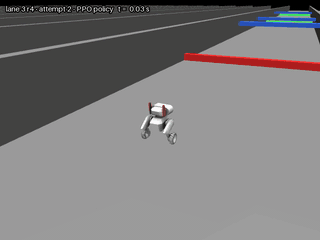</a><br>Lane 3: goal reached in 18.3 s</td>
    <td align="center"><a href="python/parkour_rl/media/comparison/rl_lane_9.mp4">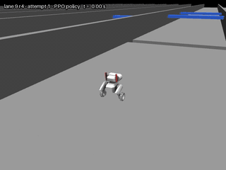</a><br>Lane 9: goal reached in 12.0 s</td>
    <td align="center"><a href="python/parkour_rl/media/comparison/rl_lane_14.mp4">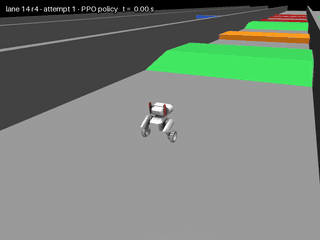</a><br>Lane 14: fell after 14.2 s</td>
  </tr>
  <tr><th colspan="3" align="left">LLM: Claude Opus 5.5</th></tr>
  <tr>
    <td align="center"><a href="python/parkour_rl/media/comparison/opus_lane_3.mp4">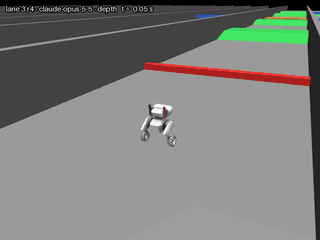</a><br>Lane 3: goal reached in 31.0 s</td>
    <td align="center"><a href="python/parkour_rl/media/comparison/opus_lane_9.mp4">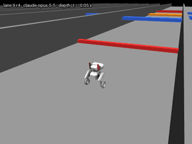</a><br>Lane 9: goal reached in 23.9 s</td>
    <td align="center"><a href="python/parkour_rl/media/comparison/opus_lane_14.mp4">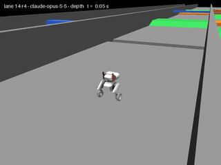</a><br>Lane 14: goal reached in 22.9 s</td>
  </tr>
  <tr><th colspan="3" align="left">LLM: Claude Haiku 5.5</th></tr>
  <tr>
    <td align="center"><a href="python/parkour_rl/media/comparison/haiku_lane_3_fail.mp4">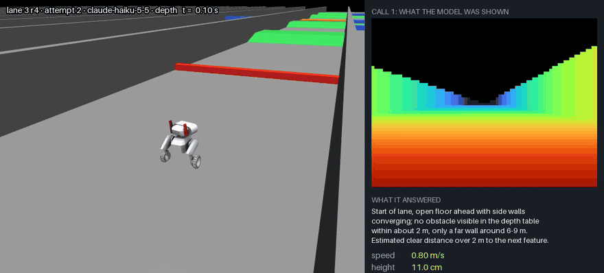</a><br>Lane 3: failed after 19.0 s</td>
    <td align="center"><a href="python/parkour_rl/media/comparison/haiku_lane_3.mp4">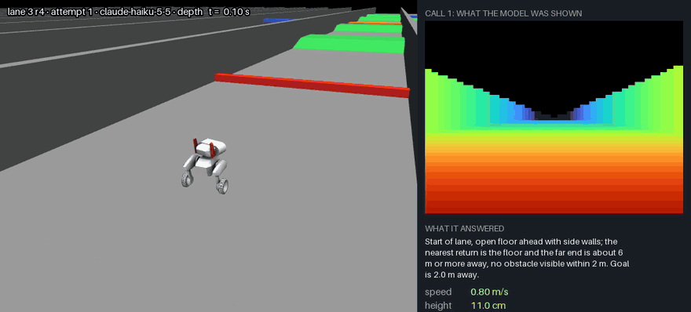</a><br>Lane 3: goal reached in 41.2 s</td>
    <td align="center"><a href="python/parkour_rl/media/comparison/haiku_lane_12.mp4">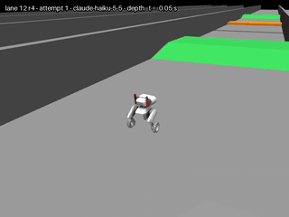</a><br>Lane 12: goal reached in 22.3 s</td>
  </tr>
  <tr><th colspan="3" align="left">LLM: Jev</th></tr>
  <tr>
    <td align="center"><a href="python/parkour_rl/media/comparison/jev_lane_2.mp4">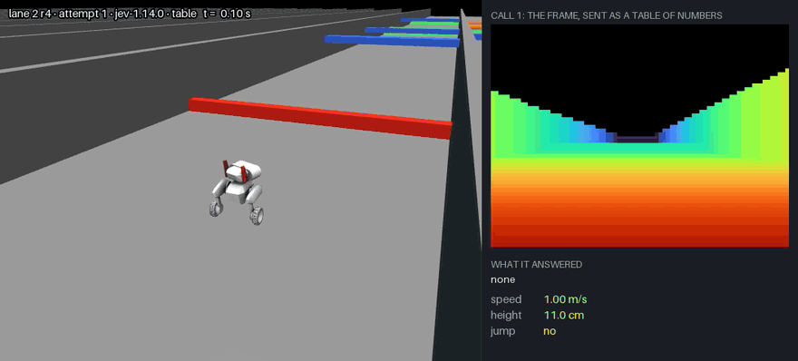</a><br>Lane 2: goal reached in 25.8 s</td>
    <td align="center"><a href="python/parkour_rl/media/comparison/jev_lane_4.mp4">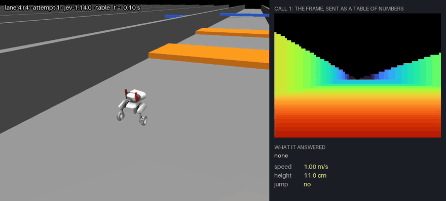</a><br>Lane 4: goal reached in 21.0 s</td>
    <td align="center"><a href="python/parkour_rl/media/comparison/jev_lane_10.mp4">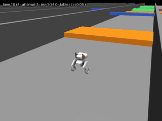</a><br>Lane 10: goal reached in 30.0 s</td>
  </tr>
</table>

## 5. Web demo

**https://huggingface.co/spaces/XueruiWang/beni-parkour**

[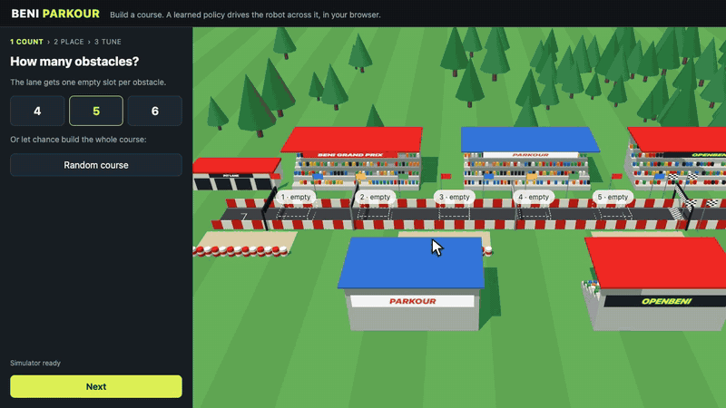](https://huggingface.co/spaces/XueruiWang/beni-parkour)

*A full session in the web demo: five obstacles, two sizes changed, then the race (editing shown 1.6 times faster,
the race in real time). [MP4](python/parkour_rl/media/web_demo.mp4)*

Choose 4 to 6 obstacles, drag them into the lane, set their sizes and spacing, and the same policy drives the robot
across. The page shows what the policy sees (the depth image) and what it decides (speed, body height, jump).

Everything runs in the visitor's browser: MuJoCo compiled to WebAssembly for the physics, ray casting for the depth
camera, ONNX Runtime Web for the four networks and three.js for the picture. The JavaScript simulation is a port of
the Python code and was checked against it step by step. Over 400 episodes on the env2 lanes it reaches the goal in
75% of them, against 76% in Python. See [parkour_web/README.md](parkour_web/README.md).

## Repository

| Path | Contents |
| --- | --- |
| `python/parkour_rl/` | the high-level task: lanes, env1 and env2, the hierarchy, depth encoder, rewards, training, evaluation |
| `python/parkour_rl/checkpoints/`, `low_level_policy/`, `depth_model/` | the released high-level policy, the two frozen low-level policies, the DeFM weights |
| `python/parkour_rl/media/` | the clips and pictures of this page; `make_media.py` makes those of 1. and 2. |
| `python/beni_rl_crawl/` | the fine-tune that gave the crawl policy |
| `python/beni_rl/`, `assets/`, `web/` | OpenBeni: low-level training, robot model, its own browser game |
| `parkour_web/` | the web demo |

## Credits and license

- [OpenBeni](https://github.com/Mondo-Robotics/open-beni) by Mondo Robotics: the robot, its model, the low-level
  training code and the jump policy. This repository starts from its source.
- [mjlab](https://github.com/mujocolab/mjlab) and MuJoCo Warp for the simulation,
  [rsl_rl](https://github.com/leggedrobotics/rsl_rl) for PPO.
- [DeFM](https://github.com/leggedrobotics/defm) (ETH Zurich, Manthan Patel) for the depth encoder.
- MuJoCo, ONNX Runtime Web and three.js in the web demo.
- Claude, through the Anthropic API, and Jev by TypeSafe as the language models of the LLM controller.

The code is under the MIT license of OpenBeni ([LICENSE](LICENSE)). The DeFM weights and preprocessing code are under
Apache-2.0; [NOTICE.md](NOTICE.md) lists the third-party parts.
